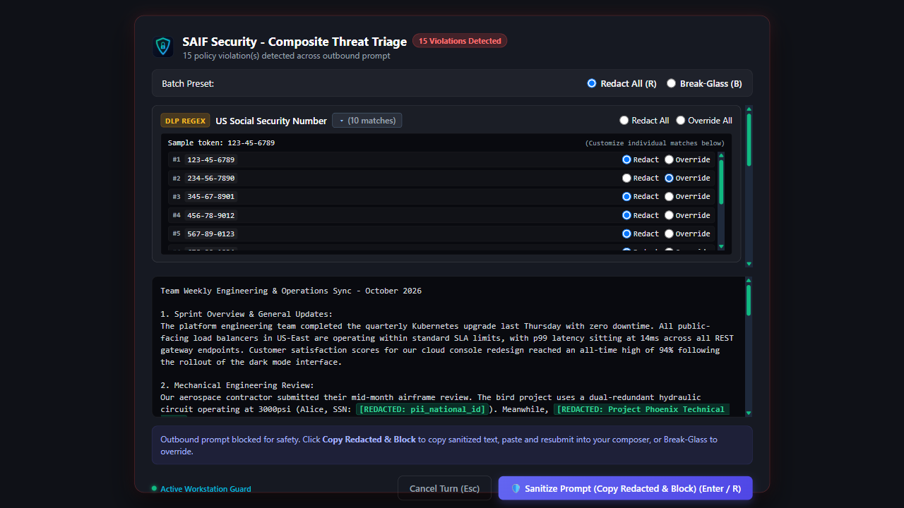

# SAIF Overrides, Snoozing & Local Audit History

> **Documentation Index**:  
> [**Overview**](../README.md) • [**Changelog (v1.0.6)**](../CHANGELOG.md) • [**Architecture Diagrams**](ARCHITECTURE.md) • [**User Guide**](USER_GUIDE.md) • [**Benchmark Whitepaper**](BENCHMARK.md) • [**Rule Catalog**](RULE_CATALOG.md) • [**Overrides & Snoozing**](OVERRIDES_AND_SNOOZE.md) • [**FAQ**](FAQ.md) • [**Benchmark Suite**](../benchmark/README.md) • [**Empirical Report**](../BENCHMARK_REPORT.md) • [**Community EULA**](../EULA.md) • [**MIT License**](../LICENSE.md)

---

SAIF is designed for **developer velocity**. Security controls should never block critical development work when you encounter a false alarm or need to urgently paste test data.

---

## 1. Unified Triage & Override Decision Matrix

When SAIF intercepts an outbound prompt—either inside a web AI chatroom via the browser extension or out-of-browser via the Antigravity IDE hook—it presents the **v1.0.6 Composite Threat Triage Modal**:

  
   
  <em>(In-Browser Unified Webview Triage Modal)</em>

### Decision Matrix & Controls

Developers have four distinct options when a violation is flagged:

| Remediation Action | Keyboard / Hotkey | Operational Behavior | Single-Trip Guarantee |
| :--- | :---: | :--- | :--- |
| **Sanitize Prompt (Redact All)** | **`Enter` / `R`** | Replaces all detected violations in descending character offset order with masked tags (e.g. `[REDACTED: pii_national_id]`). Preserves exact multi-line paragraph layout (`
 
`). | Issues `OverrideLease` for sanitized hash; bypasses redundant scans on resubmit. |
| **Break-Glass Emergency Override** | **`B`** | Logs an audited bypass event locally and permits the raw prompt to egress to the AI service. | Issues single-trip `OverrideLease` to prevent re-blocking on turn dispatch; burned on outbound transmission. |
| **Granular Item-Level Overrides** | **Click Accordion / Item Radio** | Expand individual rule drawers to inspect matched text spans, sample tokens, and toggle specific matches on or off individually before applying. | Unredacted tokens are preserved under an active item-level override lease; burned on outbound transmission. |
| **Cancel / Block** | **`Esc`** | Closes the modal. The original text remains safe on the workstation without transmitting any bytes upstream. | Prompt remains un-transmitted. |

  
   
  <em>(Desktop Triage Modal: Granular Accordion Controls & Live Diff Preview)</em>

### How the Single-Trip Override Lease Works ("Hash and Burn")
1. When you select **Break-Glass** or **Granular Item-Level Override**, SAIF generates an ephemeral, in-memory **`OverrideLease`** token bound to the specific prompt hash or session ID.
2. In the browser extension, the lease is tracked simultaneously across the isolated content script (`inPageOverriddenPrompts`), the background service worker (`overrideLeases`), and the Main-World network interceptor (`overriddenPrompts`).
3. For native IDE assistants (`saif.exe`), the override is managed across a sequential two-gate protocol:
   - **Gate 1 (`POST /api/v1/hook`)**: Turn preflight validation via `ValidateOverrideLease`. The turn is approved without destroying the lease (`HookApproved = true`).
   - **Gate 2 (Wire Proxy Request)**: Upstream wire transmission via `CheckAndConsumeOverrideLease`. The request is relayed to the external LLM provider, an `OVERRIDDEN` event is logged to the local spooler, and the lease is burned on read.
4. **Single-Trip Burn-on-Read Guarantee**: As soon as the outbound request transits the network, the lease is destroyed. If the exact same sensitive prompt is submitted a second time, the firewall immediately re-blocks it.
5. The override or redaction action is committed to your local workstation audit log (`%LOCALAPPDATA%\saif\spool.db`).

---

## 2. Time-Bounded Snoozing

If you are conducting an extended debugging session with synthetic data, you can temporarily snooze active enforcement:

1. Click the **SAIF shield icon** in your browser toolbar to open the popup.

  

2. Select a pause duration:
   - **Pause for 5 Minutes**
   - **Pause for 15 Minutes**
   - **Pause for 1 Hour**
3. While snoozed:
   - The toolbar icon displays an amber indicator.
   - All prompts transit without interception.
   - When the timer expires, enforcement resumes automatically without user action required.
4. You can click **Resume Now** at any moment to re-engage active protection immediately.

---

## 3. Local Audit History & CSV Export

SAIF records blocked and overridden events strictly to your local workstation:
- **Database Location**: `%LOCALAPPDATA%\saif\spool.db` (local SQLite database).
- **Privacy Guarantee**: Zero telemetry is sent to external servers. Your prompts never leave your device.
- **Exporting History**:
  1. Open the SAIF Extension Dashboard (`dashboard.html`).
  2. Navigate to the **Recent Violations** tab.
  3. Filter by date range, rule category, or decision type.
  4. Click **Export CSV** or **Export JSON** to save local compliance records for your team or security reviews.
